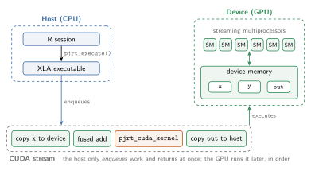
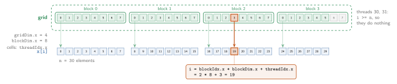
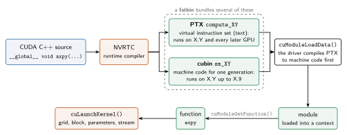
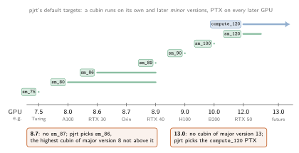
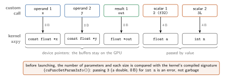
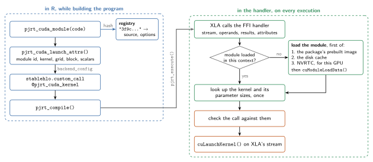
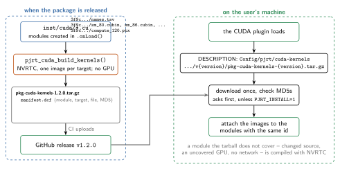

```{r setup, include = FALSE}
knitr::opts_chunk$set(
  collapse = TRUE,
  comment = "#>"
)
```

XLA compiles most programs into efficient GPU code by itself.
Some algorithms, though, cannot be expressed well in StableHLO: a loop
whose iterations depend on each other, say, turns into a `while` loop that
the host drives one iteration at a time.
For those, you can write the GPU code yourself, as a *CUDA kernel*, and
call it from a program.

The [Adding Custom Calls](ffi.html) article shows how to call into a
*library* such as cuSOLVER, which needs an XLA FFI handler written in C++
and compiled into a package.
A kernel you wrote yourself needs none of that: {pjrt} registers one
generic custom call, `pjrt_cuda_kernel`, that launches any kernel you give
it as source code.
This article first explains the CUDA concepts involved, and then how
{pjrt} uses them.

## A Short CUDA Primer

### Host and device

A GPU is a separate computer with its own memory.
The CPU, the *host*, runs R and XLA; the GPU, the *device*, runs the
computations, on data in its own *device memory*.
A `PJRTBuffer` on a CUDA device is such a piece of device memory.



The host does not wait for the GPU.
It puts work into a *stream*, a queue the GPU works through in order, and
returns at once.
This is why `pjrt_execute()` returns buffers that may not be ready yet: it
has only enqueued the program's work on a stream.
A custom call is one more item in that queue, so a kernel it launches has
to go into the same stream, after the work that computes its inputs and
before the work that reads its outputs.

### Kernels, threads and blocks

A *kernel* is a function that runs on the GPU many times in parallel, once
per *thread*.
It is written in CUDA C++, marked `__global__`, and returns nothing: it
writes its results into memory it is given pointers to.
Here is a kernel that computes `out = a * x + y`, one element per thread:

```cpp
extern "C" __global__ void axpy(const float *x, const float *y, float *out,
                                float a, int n) {
  int i = blockIdx.x * blockDim.x + threadIdx.x;
  if (i < n) out[i] = a * x[i] + y[i];
}
```

Threads are organized in two levels.
They are grouped into *blocks* of up to 1024 threads, and a launch runs a
*grid* of blocks.
Each thread finds out which one it is from built-in variables: `threadIdx`
is its index in its block, `blockIdx` the index of its block in the grid,
and `blockDim` the size of a block.
From these it computes which element to work on:



The grid usually has more threads than there are elements, as the number
of threads is a multiple of the block size.
That is why the kernel checks `i < n` before it reads or writes anything.
Grids and blocks can have up to three dimensions (`.x`, `.y`, `.z`), which
is convenient for matrices; the example only uses one.

Threads of the same block run on the same *streaming multiprocessor* (SM)
of the GPU, and can share fast on-chip *shared memory*; blocks are
independent of each other, and run in any order.
Choosing a block size of 128 or 256 threads, and enough blocks to cover the
data, is a good start.

### From source code to a running kernel

A GPU cannot run CUDA C++ directly.
The code is compiled, either ahead of time by `nvcc` from the CUDA toolkit,
or while the program runs by *NVRTC*, CUDA's runtime compiler, which is a
library.
It produces one of two kinds of *image*:



- **cubin** is machine code for one GPU generation, named `sm_XY` after the
  *compute capability* X.Y of the GPU it is compiled for.
- **PTX** is an intermediate, virtual instruction set, named `compute_XY`.
  When it is loaded, the driver compiles it into machine code for the GPU at
  hand, which takes a moment, but works on GPUs that did not exist when it
  was written.

A *fatbin* bundles several cubins and PTX into one file.
The CUDA driver loads an image into a *module*, which belongs to a
*context*: the state a process keeps on one GPU.
A kernel of a loaded module is a *function*, which `cuLaunchKernel()`
starts on a stream, with a grid and block size and the kernel's
parameters.

### GPU architectures

Which image runs on which GPU follows from its compute capability.
A cubin runs on GPUs of the same major version and an equal or later minor
version; PTX runs on its own and every later GPU, including future ones.



So a single image does not cover all GPUs.
Software that ships compiled kernels includes a cubin for every
architecture it supports, plus PTX for the GPUs that come after.
Compiling on the user's machine, as NVRTC allows, sidesteps the question:
the code is compiled for exactly the GPU it runs on.

## Running a Kernel with {pjrt}

### Creating a module

`pjrt_cuda_module()` creates a module from CUDA source:

```{r}
library(pjrt)

mod <- pjrt_cuda_module(r"(
extern "C" __global__ void axpy(const float *x, const float *y, float *out,
                                float a, int n) {
  int i = blockIdx.x * blockDim.x + threadIdx.x;
  if (i < n) out[i] = a * x[i] + y[i];
}
)")
mod
```

Creating a module needs no GPU, and compiles nothing yet.
It records the source in a registry, under an id that is a hash of the
source and options, so the same module has the same id in every session.
The module is compiled with NVRTC the first time one of its kernels runs,
for the architecture of the GPU it runs on.
NVRTC ships with the CUDA R package that the CUDA plugin uses, so no CUDA
toolkit is needed, and {pjrt} itself still builds without CUDA.

A module can also be a file, either `.cu` source or a prebuilt `.ptx`,
`.cubin` or `.fatbin` image, e.g. one compiled with `nvcc`.
Kernels declared `extern "C"` are found by their name.
A C++ kernel, such as a template, has to be listed in `kernels`, so that
NVRTC instantiates it and tells {pjrt} its compiled name:

```{r}
scale <- pjrt_cuda_module(
  r"(
template <typename T>
__global__ void scale(const T *x, T *out, T a, int n) {
  int i = blockIdx.x * blockDim.x + threadIdx.x;
  if (i < n) out[i] = a * x[i];
}
)",
  kernels = c("scale<float>", "scale<double>"),
  options = "--use_fast_math"
)
scale
```

### Launching it

A program launches a kernel through the `pjrt_cuda_kernel` custom call.
`pjrt_cuda_launch_attrs()` builds its attributes: which module and kernel
to launch, the grid and block size, and the scalar arguments.

```{r}
attrs <- pjrt_cuda_launch_attrs(
  mod, "axpy",
  grid = 1L, block = 256L,
  scalars = list(pjrt_cuda_scalar(2, "f32"), 3L)
)
str(attrs)
```

They go into the custom call's `backend_config`, with the integers as
`i32`:

```{r, eval = FALSE}
cfg <- paste(
  sprintf(
    "%s = %s", names(attrs),
    ifelse(vapply(attrs, is.character, logical(1L)),
           sprintf("\"%s\"", attrs), sprintf("%s : i32", attrs))
  ),
  collapse = ", "
)
src <- sprintf(r"(
func.func @main(%%x: tensor<3xf32>, %%y: tensor<3xf32>) -> tensor<3xf32> {
  %%0 = stablehlo.custom_call @pjrt_cuda_kernel(%%x, %%y) {
    call_target_name = "pjrt_cuda_kernel",
    api_version = 4 : i32,
    backend_config = {%s},
    operand_layouts = [dense<0> : tensor<1xindex>, dense<0> : tensor<1xindex>],
    result_layouts = [dense<0> : tensor<1xindex>]
  } : (tensor<3xf32>, tensor<3xf32>) -> tensor<3xf32>
  "func.return"(%%0) : (tensor<3xf32>) -> ()
}
)", cfg)
exec <- pjrt_compile(pjrt_program(src), device = "cuda")
x <- pjrt_buffer(c(1, 2, 3), dtype = "f32", device = "cuda")
pjrt_execute(exec, x, x)
# 3 6 9
```

In practice a front end emits the custom call for you; anvl's
`cuda_kernel()` does it for `nv_custom_call()`.
Running the program on a CPU fails with an error, as the custom call only
exists on CUDA devices.

### Parameters

The kernel receives the custom call's operands, then its results, as
device pointers, followed by the scalars:



A scalar's C type follows from its R type, as in R's `.C()` interface: an
integer is an `int`, a double a `double`, and a logical a `bool`.
For other types, such as the `float a` above, wrap the value in
`pjrt_cuda_scalar()`.
The kernel only sees bytes, so passing a value of the wrong type would
silently produce garbage.
{pjrt} therefore compares every launch with the parameters of the
compiled kernel, and reports a mismatch in their number or size as an
error.

A buffer is laid out in device memory as the custom call's
`operand_layouts` and `result_layouts` say.
With the default, row-major layout, the last axis of a matrix varies
fastest; ask for `dense<[0, 1]>` to get R's column-major order instead.

The launch configuration has two more knobs: a grid or block can have up
to three dimensions, e.g. `grid = c(16L, 16L)`, and `shared_mem` sets the
bytes of dynamic shared memory per block, which a kernel declares as
`extern __shared__`.
A grid with a zero dimension launches nothing, which is convenient for
empty inputs.

### What happens at run time

When XLA reaches the custom call, it calls {pjrt}'s handler with its
stream, the buffers and the attributes:



The first time a module runs in a CUDA context, the handler loads it.
It takes the first of:

1. the prebuilt image the module's package ships (see below),
2. the image a previous session compiled, from the disk cache,
3. a fresh compilation with NVRTC, for this GPU.

The disk cache lives in `pjrt_cuda_cache_dir()`, and the `PJRT_CUDA_CACHE`
environment variable moves it, or disables it when set to `""`.
Entries are keyed by the source, options, kernels, GPU architecture and
NVRTC version, so a module is compiled once per machine and GPU, not once
per session.
A header the module `#include`s is not part of that key, so keep modules
self-contained.

Because the module is only compiled now, a syntax error in the kernel
surfaces when the program first runs -- with anvl, when the first result
is read -- with NVRTC's log as the error message.
After loading, each kernel is looked up once, together with its parameter
sizes; every launch then only checks the call against them and starts the
kernel on XLA's stream.

## Shipping Kernels in a Package

A package can launch its own kernels the same way.
It keeps their source in `inst/cuda/` and creates their modules when it is
loaded, naming itself as their `package`:

```r
.onLoad <- function(libname, pkgname) {
  the$my_kernel <- pjrt::pjrt_cuda_module(
    file = system.file("cuda", "my_kernel.cu", package = pkgname),
    package = pkgname
  )
}
```

Its users then compile the kernels with NVRTC on first use, as above.
To spare them that, the package can ship them precompiled:



For each release, `pjrt_cuda_build_kernels()` loads the package, compiles
the modules it created for a list of targets -- by default a cubin for
every GPU generation since Turing (7.5), plus PTX for later GPUs -- and
writes them into a tarball.
This needs NVRTC but no GPU, so it runs on a regular CI runner; {pjrt}'s
own `cuda-kernels` GitHub workflow is an example.
The tarball is attached to the release, and the package names its URL in
its DESCRIPTION, `{version}` standing for its version:

```
Config/pjrt/cuda-kernels: https://github.com/org/pkg/releases/download/v{version}/pkg-cuda-kernels-{version}.tar.gz
```

When the CUDA plugin loads, {pjrt} downloads each such tarball once, under
the same `PJRT_INSTALL` rules as the plugin, checks the files against the
checksums in its manifest, and attaches the images to the modules with the
same id.
The environment variable `PJRT_CUDA_KERNELS_URL_<PACKAGE>` overrides the
URL.
The prebuilt images are only a shortcut: a module they do not cover -- a
development version whose source changed, a GPU they were not built for, a
machine without network -- is compiled with NVRTC as before.

{pjrt} ships one kernel itself this way: the `lu_pivots_to_permutation`
custom call turns the row swaps of an LU decomposition into a permutation.
The swaps of one matrix depend on each other, so StableHLO would need a
`while` loop, and on a GPU every iteration of it costs a kernel launch and
a copy to the host.
The kernel instead handles each matrix in a single thread, and all
matrices of a batch in one launch.
